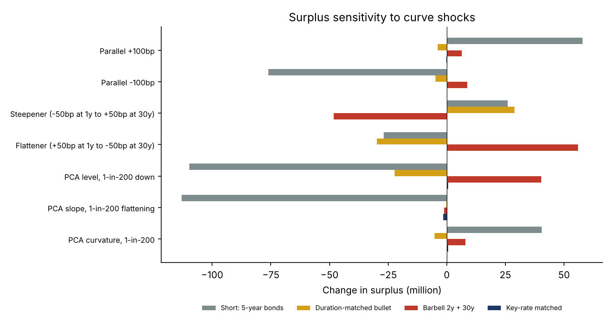
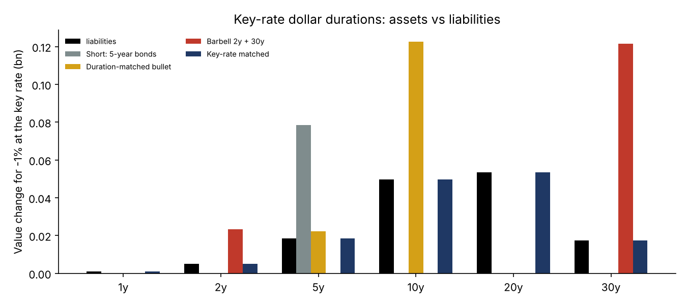
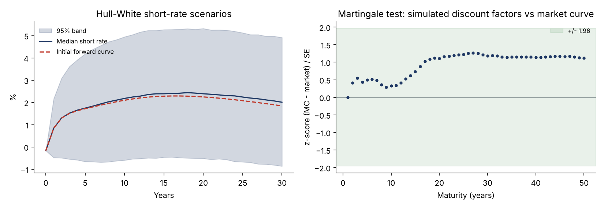
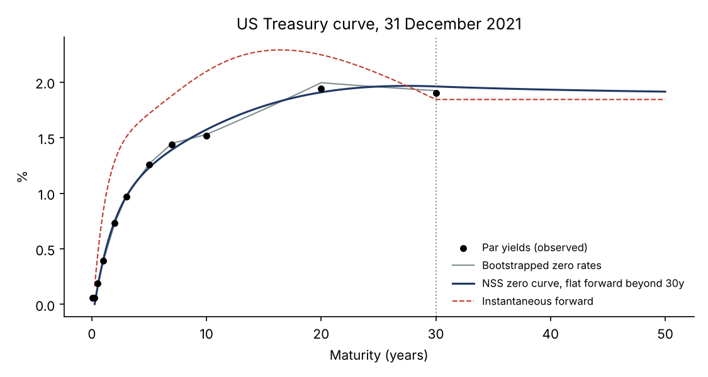
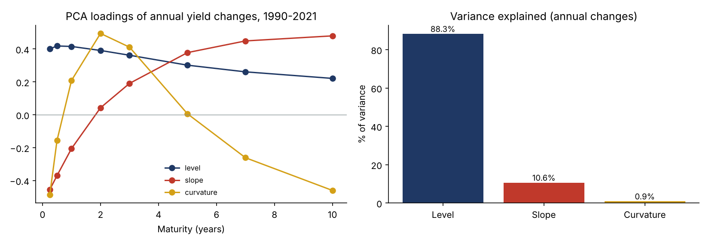

# Interest-Rate Risk and Asset-Liability Management for an Insurer

[](https://github.com/yelbakali-creator/insurer-alm-interest-rates/actions/workflows/tests.yml)

A from-scratch Python study of interest-rate risk on real US Treasury data (8,055 daily curves, 1990-2022), applied to the balance sheet of a life insurer:

1. **Curve construction**: bootstrapping a zero-coupon curve from par yields, then a Nelson-Siegel-Svensson (NSS) fit with flat-forward extrapolation beyond 30 years.
2. **Principal component analysis** of 32 years of yield changes: level, slope and curvature.
3. **Hull-White one-factor model**, calibrated on history and fitted exactly to the initial curve, with the **martingale tests** used to validate economic scenario generators.
4. **Asset-liability management** for a closed block of life annuities against four asset strategies: short, duration-matched bullet, barbell and key-rate matched.
5. **Stress tests and 1-in-200 risk**: parallel and twist shocks, data-driven PCA shocks, and the Hull-White one-year surplus distribution.

## Key results

The insurer holds a block of 10,000 life annuities (USD 10,000 a year each) worth 1,425.8m, with a duration of 10.2 years. Assets are 1,568.3m, so the surplus is 142.6m.

| Strategy | Asset duration | Asset convexity | Surplus change, rates -100bp | Steepener | **1-in-200 surplus loss (3-factor PCA)** |
|---|---|---|---|---|---|
| Short: 5-year bonds | 5.0 | 25 | -76.1m | +26.0m | **172.9m (121% of surplus)** |
| Duration-matched bullet (9.2 years) | 9.2 | 85 | -4.8m | +28.9m | **26.0m (18%)** |
| Barbell 2y + 30y | 9.2 | 235 | +8.7m | -48.2m | **18.9m (13%)** |
| Key-rate matched | 9.2 | 139 | -0.0m | +0.2m | **1.9m (1%)** |

Liability convexity is 154. The assets are worth 110% of the liabilities, so a duration-matched portfolio has a lower duration (9.2) than the liabilities (10.2) but the same dollar duration.



**What the table says:**

- **A short portfolio is a solvency event.** A 1-in-200 fall in rates destroys more than the entire surplus. This is the classic risk of life insurers in a falling-rate environment.
- **Duration matching is not enough.** It neutralises parallel moves but not twists. The bullet loses on both parallel shocks, because its convexity (85) is below the liabilities' (154). The barbell gains on parallel shocks, because its convexity is higher (235), but it loses 48m on a steepener.
- **Key-rate matching immunises the surplus** against any curve shape, cutting the 1-in-200 loss from 26m to 1.9m.



## Validation

| Check | Result |
|---|---|
| Bootstrap: every par bond reprices at 100 | max error 3e-14 |
| NSS fit vs bootstrapped zero rates | RMSE 3.7bp, max 8.6bp |
| Liabilities: Macaulay duration vs effective (finite-difference) duration | 10.1559 = 10.1559 (identity under continuous compounding) |
| Sum of key-rate dollar durations / total dollar duration | 0.9999998 |
| Hull-White martingale test: simulated vs market discount factors, 50 maturities, 20,000 paths | max \|z\| = 1.27 |
| Hull-White: E[D(0,5) P(5,T)] = P(0,T), T = 10, 20, 30 (simulation + analytic bond formula) | ratios 1.0003 - 1.0005, z-scores 0.54 - 0.57 |
| PCA: variance explained by three factors (monthly changes) | 98.4%, consistent with the literature |

**The martingale test** checks that the average of simulated discount factors reproduces today's market curve. A scenario generator that fails it would misprice even plain bonds. The second test checks that the analytic Hull-White bond formula, applied at year 5 on simulated paths and discounted back, also returns today's prices. Because all maturities use the same paths, the z-scores are correlated across maturities.



## The yield curve



- **Bootstrap.** Par yields are interpolated on a semi-annual grid, and discount factors are bootstrapped so that every par bond reprices at 100.
- **Smoothing.** The NSS curve smooths the bootstrapped zero rates.
- **Extrapolation.** Beyond 30 years, the last liquid point, the instantaneous forward is held flat at 1.84%. Annuity cash flows run to 50 years, so this extrapolation matters, in the same spirit as the regulatory extrapolation used for insurers.

## What drives interest rates: PCA



| Factor | Share of variance (monthly) | Share of variance (annual) | 1-in-200 annual shock (normal) | 1-in-200 shock (empirical, up / down) |
|---|---|---|---|---|
| Level | 80.7% | 88.3% | 7.7% | 7.8% / -7.9% |
| Slope | 15.0% | 10.6% | 2.7% | 2.6% / -2.5% |
| Curvature | 2.7% | 0.9% | 0.8% | 0.8% / -0.7% |

Shocks are on the factor scores, whose loadings have unit length across 8 tenors. Normal and empirical 1-in-200 shocks agree closely.

**Approximation.** The PCA is estimated on changes in **par** yields (the published series), but the shocks are applied to the **zero-coupon** curve, interpolated across maturities and held flat beyond 10 years. For moves of this size, par and zero-rate changes are close, but not identical. The 1-in-200 surplus loss is obtained by simulating 20,000 combinations of the three factors and revaluing assets and liabilities.

## Model risk: single-factor vs multi-factor

| Strategy | Hull-White: 0.5% quantile of surplus after one year | PCA 3-factor: 1-in-200 loss |
|---|---|---|
| Short | 111.3m | 172.9m |
| Duration-matched bullet | 115.5m | 26.0m |
| Barbell | 103.2m | 18.9m |
| Key-rate matched | 142.9m | 1.9m |

The two models **rank the strategies differently**. In the one-factor Hull-White model, all rates move together, with shocks that fade with maturity, so the model cannot produce the independent slope moves that hurt the short portfolio most. The three-factor PCA captures them.

Lesson: a one-factor model is fine for market-consistent valuation (it passes the martingale tests), but risk measurement needs at least the level and slope factors.

**Caveat.** The one-year Hull-White distribution uses the risk-neutral dynamics fitted to today's curve (with a volatility estimated on history), not a real-world projection of rates. It illustrates how a one-factor structure shapes the risk, rather than giving a real-world 1-in-200 estimate.

## Method notes

- **Hull-White:** dr = (theta(t) - a r) dt + sigma dW, with theta(t) fitted to the initial curve. Simulation is exact: the Ornstein-Uhlenbeck state and its integral are drawn jointly from their Gaussian distribution, so there is no discretisation bias.
- **Calibration:** a = 0.117 and sigma = 0.72% are estimated by AR(1) on the monthly 3-month yield, 1990-2021. This is a real-world calibration; market-consistent valuation would calibrate to swaption prices.
- **Liabilities:** expected annuity payments with Gompertz-Makeham survival from age 65.
- **Assets:** zero-coupon bonds. The key-rate portfolio holds one bond at each key rate (1, 2, 5, 10, 20, 30 years), sized to match the liabilities' key-rate dollar durations, with the rest in cash.
- **Key-rate durations:** triangular 1bp bumps of the zero curve at each key rate.

## Repository structure

```
├── run_study.py        # curve, PCA, Hull-White, balance sheet, shocks, charts
├── data/
│   └── ust_raw.csv     # US Treasury daily par yield curves, 1990-2022
├── src/
│   ├── curve.py        # loading, bootstrap, NSS, extrapolated zero curve
│   ├── rates_models.py # PCA of yield changes, Hull-White calibration and exact simulation
│   └── alm.py          # liability cash flows, durations, convexity, key-rate durations
└── results/
    ├── figures/
    ├── tables/
    └── run_log.txt
```

## How to run

```bash
pip install -r requirements.txt
python -m pytest       # 4 automated validation tests
python run_study.py
```

## Limitations and next steps

- **Absolute shocks.** The PCA shocks are absolute and calibrated on 1990-2021, when rates started near 8%. Applied to the low-rate curve of 2021, a 1-in-200 fall would push rates well below zero. Regulatory approaches use shocks that depend on the rate level, with floors.
- **Short end of the NSS curve.** The fit gives an instantaneous short rate of -0.17% against a 1-month yield of 0.06%, because the long-term level parameter sits at its zero bound. The 20-year yield (1.94%) is above the 30-year (1.90%).
- **Next steps:** a two-factor model (G2++) calibrated to swaptions; Smith-Wilson extrapolation to an ultimate forward rate as under Solvency II; liabilities with guarantees and policyholder options; a dynamic rebalancing strategy.

## Data

US Treasury Daily Par Yield Curve Rates (U.S. Department of the Treasury), as compiled in the open-source `data-ust` repository (E. Pogrebnyak), January 1990 to March 2022.

---

**Author:** Yassine El Bakali, MSc in Actuarial Science (ULB) · yelbakali@yahoo.be
